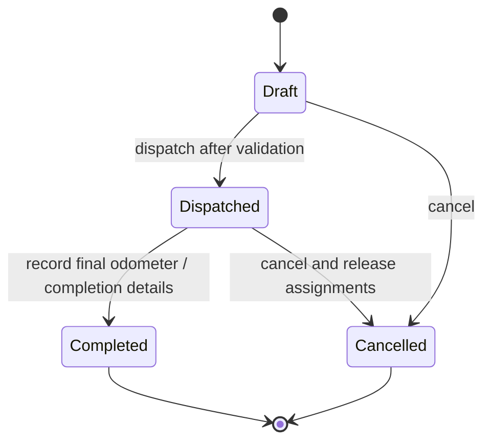
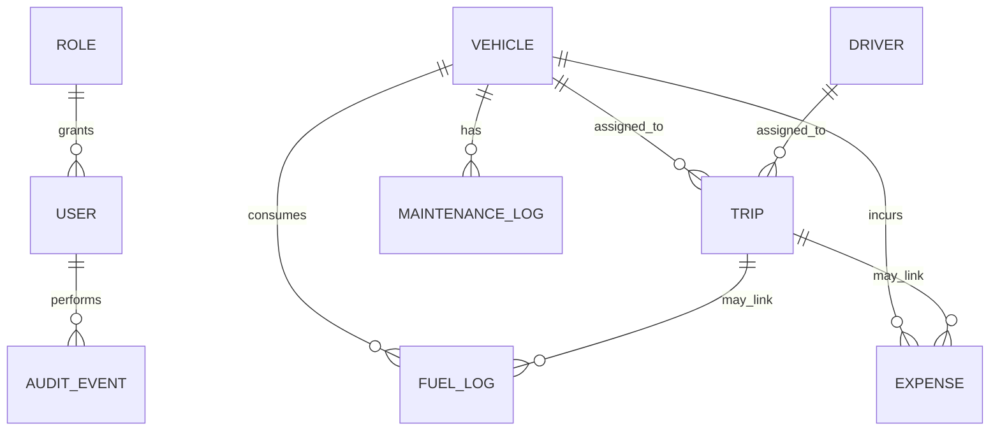

# TransitOps - Product Requirements Document

| Field | Value |
| --- | --- |
| Product | TransitOps - Smart Transport Operations Platform |
| Document status | Draft v1.0 |
| Primary delivery | Responsive web application |
| Original time-box | 8-hour hackathon MVP |
| Source material | Project brief PDF and nine UI mockups in `docs/` |

## 1. Product summary

TransitOps is a centralized fleet-operations application for logistics organizations. It replaces spreadsheets and manual logbooks with a single, role-aware system for registering vehicles and drivers, dispatching trips, tracking maintenance and operating costs, and monitoring fleet performance.

The product must make operational constraints visible and enforceable. A dispatcher should only be able to assign a vehicle and driver that are currently eligible; a fleet manager should immediately see maintenance impact; and finance users should have dependable inputs for cost and ROI reporting.

### 1.1 Problem statement

Manual fleet management causes overlapping assignments, idle or underused vehicles, late maintenance, expired-license assignments, inconsistent cost records, and limited insight into operations. TransitOps addresses these failures by maintaining a trusted operational state for each vehicle, driver, and trip and by deriving dashboard and reporting metrics from those records.

### 1.2 Product vision

Give every transport operator an accurate, current view of the fleet and a safe workflow for moving an order from draft to completed delivery without violating capacity, availability, maintenance, or driver-compliance rules.

### 1.3 Goals

1. Centralize fleet, driver, trip, maintenance, fuel, and expense data.
2. Prevent invalid dispatches before they are committed.
3. Automate the status transitions that otherwise require manual coordination.
4. Surface operational and financial KPIs for fast decision-making.
5. Provide responsive, role-scoped access to the system.

### 1.4 Non-goals for the MVP

- Real-time GPS/telematics tracking and route optimization.
- Customer-facing shipment tracking, invoicing, or proof-of-delivery workflows.
- Payroll, payroll compliance, or driver shift scheduling.
- Multi-organization tenancy and complex approval chains.
- Full accounting-ledger integration.

These can be considered future enhancements after the core workflow is stable.

## 2. Users and access model

The supplied material contains one terminology mismatch: the written brief calls out a **Driver** user, while the authentication and settings mockups show a **Dispatcher** role. For the MVP, a driver is treated as a managed operational profile rather than a system login; Dispatcher is the role that creates and dispatches trips. This decision should be confirmed with the product owner before production launch.

| Role | Primary objective | Default access |
| --- | --- | --- |
| Fleet Manager | Maintain fleet health, lifecycle, and utilization. | Full dashboard; vehicle registry; maintenance; read access to analytics. |
| Dispatcher | Plan and run deliveries without invalid resource assignments. | Dashboard and trip management. |
| Safety Officer | Maintain compliant driver records and investigate safety/eligibility. | Driver management and compliance visibility; read trip visibility if needed. |
| Financial Analyst | Monitor fuel, maintenance, expenses, cost, and ROI. | Read dashboard; fuel and expense management; analytics and exports. |
| Administrator (optional) | Manage user accounts, roles, and depot settings. | Settings and RBAC administration. |

### 2.1 RBAC requirements

- Authentication is required for every application route and API action except login/logout and password-recovery endpoints.
- Permissions must be enforced server-side; hiding a navigation item alone is insufficient.
- The navigation and accessible actions must adapt to the signed-in role.
- The settings screen displays a role-to-module permission matrix. The mockup indicates Fleet Manager access to Fleet, Drivers, and Analytics; Dispatcher access to Trips; Safety Officer access to Drivers and trip visibility; and Financial Analyst access to Fuel & Expenses and Analytics.
- A user must not elevate their own permissions.
- Audit records should capture user, action, target record, timestamp, and before/after state for status-changing operations.

## 3. Scope and success criteria

### 3.1 MVP scope

| Capability | MVP outcome |
| --- | --- |
| Authentication and RBAC | Email/password sign-in and protected, role-scoped screens. |
| Dashboard | Current fleet and trip KPIs, filters, recent trips, and status distribution. |
| Vehicle registry | Searchable/filterable vehicle master data with create, read, update, and retire workflows. |
| Driver management | Driver profile CRUD, license compliance visibility, safety score, and working status. |
| Trip management | Draft, dispatch, complete, and cancel lifecycle with eligibility and capacity validation. |
| Maintenance | Active/completed service records that automatically reserve/release vehicles. |
| Fuel and expenses | Fuel logging, other operating expenses, calculated total operating cost. |
| Analytics | Fuel efficiency, utilization, operating cost, ROI, monthly revenue visualization, costliest vehicles, CSV export. |

### 3.2 Measurable success criteria

- 100% of attempted dispatches violating a mandatory rule are rejected with an actionable reason.
- A successful dispatch updates the trip, vehicle, and driver state atomically.
- An active maintenance record immediately removes its vehicle from dispatch eligibility.
- Dashboard counts and analytics reflect committed changes without manual recalculation.
- A permitted user can export filtered analytics data as CSV.
- The core experience remains usable at common mobile/tablet and desktop widths.

## 4. Core operational model

### 4.1 Vehicle status

| Status | Meaning | Eligible for new trip selection? | Allowed transitions |
| --- | --- | --- | --- |
| Available | Active and unreserved. | Yes | On Trip, In Shop, Retired |
| On Trip | Assigned to a dispatched trip. | No | Available on trip completion/cancellation |
| In Shop | Has an active maintenance record. | No | Available when maintenance closes; Retired by authorized user |
| Retired | Permanently removed from active fleet. | No | None in MVP (reinstate is out of scope) |

### 4.2 Driver status

| Status | Meaning | Eligible for new trip selection? | Allowed transitions |
| --- | --- | --- | --- |
| Available | Active, available driver with valid license. | Yes | On Trip, Off Duty, Suspended |
| On Trip | Assigned to a dispatched trip. | No | Available on trip completion/cancellation |
| Off Duty | Not available for dispatch. | No | Available, Suspended |
| Suspended | Blocked from operation. | No | Available only after authorized resolution |

An expired license independently blocks assignment, even if the driver status is Available.

### 4.3 Trip state machine

| State | Description | Resource effect |
| --- | --- | --- |
| Draft | A proposed trip; editable and not yet operating. | No vehicle/driver state change. |
| Dispatched | Validated, active trip. | Assigned vehicle and driver become On Trip. |
| Completed | Delivery has ended and actual trip details are captured. | Vehicle and driver return to Available, unless the vehicle has since been retired or placed in maintenance. |
| Cancelled | Trip will not proceed. | Any dispatched vehicle and driver return to Available, subject to active maintenance/retirement constraints. |

## 5. Functional requirements

### FR-01: Authentication

1. The system shall provide email and password sign-in.
2. The login page shall include email, password, selected role (if role-aware login is retained), Remember me, and Forgot password entry points as shown in the mockup.
3. Failed credentials shall display a clear error without revealing whether the email account exists.
4. The implementation should rate-limit or temporarily lock sign-in after five failed attempts, as indicated by the mockup.
5. On successful login, the user shall be routed to the highest-priority permitted module, normally Dashboard.
6. Logout shall invalidate the active session and return the user to Login.

### FR-02: Dashboard

1. The dashboard shall show cards for Active Vehicles, Available Vehicles, Vehicles in Maintenance, Active Trips, Pending Trips, Drivers On Duty, and Fleet Utilization (%).
2. It shall provide filters for vehicle type, vehicle status, and region. Filter values shall update all cards and supporting widgets consistently.
3. It shall show a Recent Trips table including trip ID, vehicle, driver, status, and ETA or relevant status note.
4. It shall show vehicle-status distribution for Available, On Trip, In Shop, and Retired vehicles.
5. Dashboard data shall be scoped to the signed-in user's permitted organization/depot context when that context is introduced.

### FR-03: Vehicle registry

1. Users with Fleet permission shall create, view, edit, filter, search, and retire vehicles.
2. Each vehicle shall include: registration number, display name/model, type, maximum load capacity, current odometer, acquisition cost, status, and optional region/depot.
3. Registration number is required, normalized for comparison, and unique across the active organization.
4. The list shall support type and status filters and registration-number search.
5. The UI shall make current status visually recognizable and prevent direct edits that contradict active trips or maintenance.
6. Retiring a vehicle shall require confirmation and shall be blocked while the vehicle is On Trip or has active maintenance.

### FR-04: Driver and safety profiles

1. Users with Driver-management permission shall create, view, edit, search, and update the operational status of drivers.
2. A driver profile shall include: name, license number, license category, license expiry date, contact number, safety score, status, and optional region/depot.
3. License number shall be unique within the organization.
4. The list shall prominently identify expired licenses and suspended, off-duty, available, and on-trip status.
5. A driver's safety score is a numeric indicator displayed as a percentage; the scoring algorithm is out of scope for MVP, but authorized users may maintain the value.
6. The product shall prohibit a suspended driver or driver with an expired license from dispatch selection.

### FR-05: Trip dispatcher

1. Authorized users shall create a draft trip with source, destination, vehicle, driver, cargo weight, planned distance, and optional planned departure/ETA, revenue, notes, and external reference.
2. Vehicle and driver selectors shall display only currently eligible records by default; the system shall still validate eligibility on submit to prevent stale-page or concurrent updates.
3. The trip screen shall display lifecycle progress and a live board of Draft, Dispatched, Completed, and Cancelled trips.
4. The form shall display capacity information and explicitly state the overage when cargo exceeds capacity. Dispatch must be disabled in that condition.
5. Dispatch shall commit the trip state and both resource states in one transaction.
6. Completing a trip shall capture final odometer; it may capture actual distance, fuel consumed, completion timestamp, revenue, and notes. If a fuel log is created during completion, it must be recorded as an ordinary fuel log with a trip link.
7. Cancelling a dispatched trip shall record an optional reason and release its resources. Cancelling a Draft trip has no resource effect.
8. Completed and cancelled trips shall be immutable except for permitted financial corrections, which must be audited.

### FR-06: Maintenance management

1. Authorized users shall create a maintenance record with vehicle, service type, date, cost, status, supplier/notes (optional), and completion date where relevant.
2. Maintenance status shall include Active/In Shop and Completed; the internal representation may use `ACTIVE` and `COMPLETED`.
3. Creating an active maintenance record shall change the vehicle status to In Shop immediately and prevent new dispatch selection.
4. The system shall not create active maintenance for a vehicle that is currently On Trip.
5. Closing the final active maintenance record shall restore the vehicle to Available unless it is Retired.
6. Maintenance cost shall contribute to operating-cost and ROI calculations.

### FR-07: Fuel and expense management

1. Authorized users shall log fuel with vehicle, date, liters, total cost, odometer (recommended), vendor (optional), and optional linked trip.
2. The system shall support other expenses, at minimum toll and miscellaneous, with date, amount, vehicle and/or trip link, category, and notes.
3. Amounts and liters must be positive; dates cannot be in the future unless a user has an explicit planned-entry permission.
4. The screen shall list fuel logs and other expenses separately, with entry actions for Log Fuel and Add Expense.
5. The system shall calculate total operational cost per vehicle as Fuel Cost + Maintenance Cost. Other expenses shall be separately reportable and may be added to an expanded total-cost metric.

### FR-08: Reports and analytics

1. Analytics shall show Fuel Efficiency, Fleet Utilization, Operational Cost, and Vehicle ROI as primary metric cards.
2. Analytics shall include a monthly revenue chart and ranked top-costliest vehicles, consistent with the mockup.
3. Users shall be able to filter reports by date range and, where applicable, vehicle type, vehicle, region, and status.
4. CSV export shall export the currently filtered report dataset with headers and stable field names. PDF export is a bonus feature.
5. Metric definitions shall be visible through labels, tooltips, or a metric glossary.

### FR-09: Settings and organization preferences

1. The settings screen shall maintain depot name, currency, and distance unit.
2. The settings screen shall display the RBAC matrix; only administrators or authorized fleet managers may change settings or role assignments.
3. Currency and distance-unit settings shall be reflected consistently throughout display and exports; stored values shall use canonical numeric units.

## 6. Mandatory business rules

| ID | Rule | Enforcement point |
| --- | --- | --- |
| BR-01 | Vehicle registration number must be unique. | Vehicle create/update validation and database constraint. |
| BR-02 | Retired and In Shop vehicles must never appear in dispatch selection. | Eligibility query and server-side dispatch validation. |
| BR-03 | A Suspended driver or driver with an expired license cannot be assigned. | Eligibility query and server-side dispatch validation. |
| BR-04 | A vehicle or driver already On Trip cannot be assigned to another active trip. | Transactional dispatch validation. |
| BR-05 | Cargo weight cannot exceed vehicle maximum load capacity. | Draft validation and dispatch validation. |
| BR-06 | Dispatching updates vehicle and driver to On Trip. | Single database transaction. |
| BR-07 | Completing a trip returns vehicle and driver to Available. | Single database transaction, unless subsequent valid state (maintenance/retirement) applies. |
| BR-08 | Cancelling a dispatched trip restores vehicle and driver availability. | Single database transaction, subject to active maintenance/retirement state. |
| BR-09 | Creating active maintenance changes vehicle to In Shop. | Single database transaction. |
| BR-10 | Closing maintenance restores vehicle availability unless retired. | Single database transaction after verifying no other active maintenance record. |
| BR-11 | A vehicle cannot have overlapping active maintenance records unless the product deliberately supports multiple concurrent work orders. | Maintenance create validation; MVP should disallow overlap. |
| BR-12 | Required financial values and odometer values cannot be negative. | Form/API validation and database checks. |

## 7. Data requirements

### 7.1 Entity model

| Entity | Required fields | Key constraints / notes |
| --- | --- | --- |
| User | id, name, email, password hash, role ID, active flag | Email unique; never store plain-text passwords. |
| Role | id, name, permission set | Seed Fleet Manager, Dispatcher, Safety Officer, Financial Analyst. |
| Vehicle | id, registration number, name/model, type, capacity kg, odometer km, acquisition cost, status | Registration unique; capacity, odometer, and acquisition cost are non-negative. |
| Driver | id, name, license number, category, expiry date, contact, safety score, status | License unique; safety score range 0-100. |
| Trip | id, source, destination, vehicle ID, driver ID, cargo kg, planned distance km, state | Store timestamps, final odometer, actual distance, revenue, notes, cancellation reason. |
| Maintenance Log | id, vehicle ID, service type, status, date, cost | Supports active/completed state and optional completion date. |
| Fuel Log | id, vehicle ID, date, liters, cost | May link to trip and capture odometer/vendor. |
| Expense | id, category, amount, date | May link to vehicle and/or trip; categories include toll and miscellaneous. |
| Audit Event | id, actor, event type, target type/ID, timestamp | Stores state-changing event metadata. |

### 7.2 Calculations

| Metric | Definition |
| --- | --- |
| Active Vehicles | Vehicles not Retired. |
| Available Vehicles | Vehicles with status Available. |
| Vehicles in Maintenance | Vehicles with status In Shop. |
| Active Trips | Trips with status Dispatched. |
| Pending Trips | Trips with status Draft. |
| Drivers On Duty | Drivers with status On Trip (confirm whether Available but scheduled drivers should also count in a later release). |
| Fleet Utilization | `On Trip vehicles / Active Vehicles * 100`. Define the date basis for historical reporting before launch. |
| Fuel Efficiency | `Distance traveled / Fuel liters`. Use actual completed-trip distance where available; otherwise odometer delta. Do not calculate when liters is zero. |
| Operational Cost | `Fuel Cost + Maintenance Cost` for the selected scope, per the source brief. |
| Expanded Operating Cost | `Fuel + Maintenance + Tolls + Other Expenses`; label distinctly if shown. |
| Vehicle ROI | `(Revenue - (Maintenance Cost + Fuel Cost)) / Acquisition Cost * 100`. Return N/A when acquisition cost is zero or missing. |

## 8. UX and interface requirements

- Use a persistent sidebar navigation with Dashboard, Fleet, Drivers, Trips, Maintenance, Fuel & Expenses, Analytics, and Settings, filtered by role.
- Provide a global search entry point where feasible; module-level search must remain available for core registries.
- Use consistently colored status chips: Available/Completed (green), On Trip/Dispatched (blue), In Shop (amber), Retired/Cancelled (red), Draft/Off Duty (gray). Do not rely on color alone; include status text.
- Forms must show required fields, field-level validation, and a plain-language explanation of blocked actions.
- List screens must be keyboard-operable, readable at 200% zoom, and responsive. On smaller screens, tables may collapse to cards while retaining all key information.
- Destructive actions (retire, cancel, suspend) must require confirmation and show their operational consequence.
- Empty states should explain how to add the first vehicle, driver, trip, or log.
- The UI should preserve the supplied mockups' hierarchy: filter controls and KPI cards at the top, data tables or operational boards below, and clear primary action buttons.

## 9. Non-functional requirements

### Security and privacy

- Hash passwords with a modern adaptive algorithm; secure session tokens with HTTP-only, Secure, and appropriate SameSite cookie settings.
- Use TLS in deployed environments and encrypt sensitive data at rest where platform capabilities permit.
- Validate and authorize every mutation at the API boundary.
- Protect against common web threats including injection, broken access control, CSRF (where applicable), XSS, and insecure direct-object references.
- Mask contact details where role access does not require the full value.
- Log authentication attempts and sensitive state changes without logging passwords or secrets.

### Reliability and integrity

- Status-changing workflows must be atomic and resilient to duplicate submissions.
- Apply database uniqueness and foreign-key constraints in addition to form validation.
- Use optimistic locking or an equivalent concurrency strategy for vehicle, driver, and trip dispatch decisions.
- Provide user-friendly recovery messages when an item becomes unavailable after the page was loaded.
- Retain completed records and audit history; do not hard-delete financial or completed-trip records in the MVP.

### Performance and quality

- Typical dashboard and registry pages should load in under 2 seconds for a small-to-medium fleet under normal network conditions.
- Filter/search interactions should return within 1 second for the MVP data volume.
- Support current versions of Chrome, Edge, Firefox, and Safari.
- Provide responsive layouts from 360 px width upward and desktop-optimized workflows at 1280 px and above.
- Use accessible labels, semantic structure, focus states, contrast-compliant colors, and screen-reader-readable status/error messages.

## 10. Acceptance scenarios

| ID | Given | When | Then |
| --- | --- | --- | --- |
| AC-01 | A signed-out visitor | Opens an application route | They are redirected to Login. |
| AC-02 | A vehicle with registration GJ01AB1234 exists | User tries to create another using the same normalized registration | Save is rejected with a uniqueness error. |
| AC-03 | A 500 kg available van and an eligible driver exist | Dispatcher dispatches 450 kg cargo | Trip becomes Dispatched; both assignments become On Trip. |
| AC-04 | The same 500 kg van is selected | Dispatcher enters 700 kg cargo | Dispatch is blocked and the UI states that capacity is exceeded by 200 kg. |
| AC-05 | A driver has an expired license | Dispatcher opens driver selection | The driver is absent from eligible choices and cannot be dispatched through the API. |
| AC-06 | A vehicle has an active maintenance log | Dispatcher opens vehicle selection | The vehicle is unavailable; its status is In Shop. |
| AC-07 | A dispatched trip is completed | User enters final odometer and submits | Trip becomes Completed and its available resources are released according to business rules. |
| AC-08 | A dispatched trip is cancelled | User confirms cancellation | Trip becomes Cancelled and its resources are released according to business rules. |
| AC-09 | Fuel and maintenance are logged for a vehicle | Financial Analyst views analytics | Operational Cost equals fuel cost plus maintenance cost for the selected scope. |
| AC-10 | Financial Analyst filters a report | Exports CSV | The exported rows and columns match the active filters and visible metric scope. |

## 11. Delivery priorities

### Must have (hackathon MVP)

- Protected login and server-enforced RBAC.
- Vehicle and driver CRUD with the mandatory fields and validations.
- Trip creation and lifecycle, including all mandatory dispatch rules.
- Maintenance state transitions.
- Fuel and expense entry.
- Dashboard KPI cards and a usable analytics view.
- CSV export and responsive interface.

### Should have

- Global search, list sorting, and fuller date/region filters.
- Audit trail for key transitions.
- Dashboard status charts and costliest-vehicle ranking.
- Depot configuration and currency/distance preferences.

### Could have / bonus

- PDF export.
- Email reminders for approaching license expiry.
- Vehicle document storage and expiry management.
- Dark mode.
- Historical utilization trends and richer revenue analytics.

## 12. Risks, decisions, and open questions

| Topic | Current decision / risk | Required follow-up |
| --- | --- | --- |
| Dispatcher vs Driver role | Source materials conflict. This PRD uses Dispatcher as the application role and Driver as a managed record. | Confirm role model and whether drivers need self-service logins. |
| Driver assignment rule | The brief requires a driver to be Available; mockups also show Off Duty. | Confirm whether Off Duty can be scheduled for a future trip or must remain blocked. |
| Trip completion fuel | Brief says completion may enter fuel consumed, while Fuel Logs are a separate module. | Decide whether completion creates a linked fuel log automatically or only prompts the user. |
| Operating-cost definition | Brief defines Fuel + Maintenance, but UI labels other expenses. | Show both basic and expanded cost definitions, or obtain a single finance-approved definition. |
| Revenue source | ROI needs revenue but the core trip fields do not explicitly require it. | Add optional trip revenue for MVP or define an external revenue import/manual entry. |
| Region | Dashboard mockup includes region filter; entity definitions do not. | Decide whether region lives on vehicle, depot, trip, or all three. |
| Maintenance concurrency | Multiple active work orders could create ambiguous release rules. | Disallow overlapping active maintenance in MVP. |
| License reminders | Identified as a bonus. | Define reminder lead times, notification channel, and recipients before building. |

## 13. End-to-end reference workflow

1. A fleet manager registers **Van-05** with 500 kg capacity and Available status.
2. A safety officer registers **Alex** with a valid license and Available status.
3. A dispatcher creates a draft trip with 450 kg cargo and selects Van-05 and Alex.
4. TransitOps confirms the cargo does not exceed 500 kg and both assignments remain eligible.
5. The dispatcher dispatches the trip. The trip becomes Dispatched; Van-05 and Alex become On Trip.
6. On delivery completion, the dispatcher records the final odometer and optional fuel details. The trip becomes Completed, and the assigned records return to Available unless another valid operational state applies.
7. A fleet manager logs an Oil Change as active maintenance for Van-05. Van-05 moves to In Shop and disappears from dispatch options.
8. The maintenance record is closed. Van-05 returns to Available, unless it was retired.
9. Fuel, maintenance, and expense entries update operational cost, fuel efficiency, and ROI views for the financial analyst.

## Appendix A: Source-to-requirement traceability

| Source area | Reflected in this PRD |
| --- | --- |
| Project brief: business context and target users | Product summary, problem statement, roles. |
| Project brief: functional requirements 3.1-3.8 | FR-01 through FR-08. |
| Project brief: mandatory business rules | Section 6 and acceptance scenarios. |
| Project brief: expected entities/deliverables/bonus features | Data model, delivery priorities, and roadmap. |
| Authentication mockup | Login controls, role-scoped access, lockout expectation. |
| Dashboard mockup | KPI set, filters, recent trips, status distribution. |
| Vehicle and Driver mockups | Fields, status states, search/filter, eligibility rules. |
| Trip Dispatcher mockup | Lifecycle board, availability-only selectors, capacity warning. |
| Maintenance mockup | Service log structure and In Shop transition. |
| Fuel & Expenses mockup | Separate fuel and other-expense records; operating-cost display. |
| Analytics mockup | Metric cards, revenue trend, costliest vehicle view, ROI formula. |
| Settings/RBAC mockup | Depot preferences and permission matrix. |
