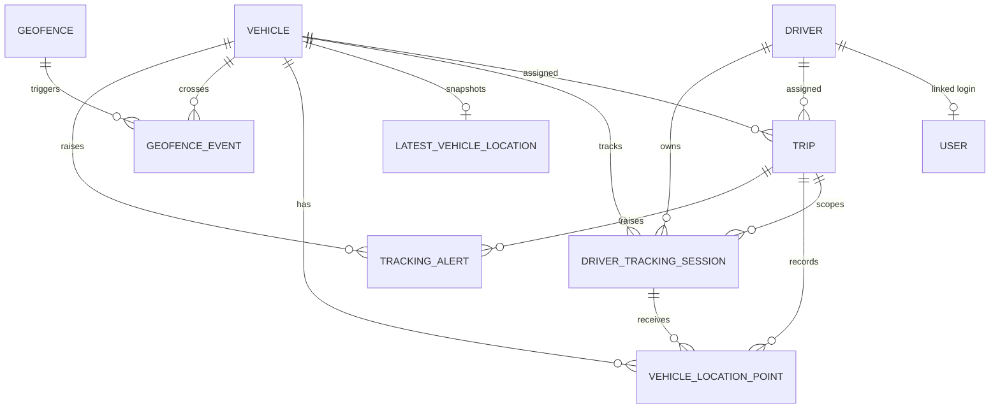

# Fleet tracking architecture

## Runtime flow

1. A dispatcher assigns a vehicle and driver to a trip.
2. The linked driver user opens **My Live Trip**, grants browser location permission, and explicitly starts sharing.
3. The API derives driver, vehicle, and trip from the authenticated user and active assignment. Client-provided association IDs are not trusted.
4. The phone sends movement-aware GPS points. Failed requests enter an IndexedDB queue and are replayed chronologically with idempotency keys.
5. A transaction stores the raw point, updates the vehicle snapshot, evaluates geofences, updates the session, and emits a live event.
6. Authorized manager screens consume authenticated server-sent events. A 20-second REST poll remains active as a recovery path.
7. Completing/cancelling a trip, signing out, or ending the session stops server acceptance for that session.

SSE fan-out is process-local in this MVP. A multi-instance deployment should replace the broker with Redis, NATS, or a managed pub/sub service.

## Entity relationships

`VehicleLocationPoint` is immutable history. `LatestVehicleLocation` is the fast one-row-per-vehicle read model. A tracking session is scoped to exactly one authenticated driver, assigned vehicle, and active trip. Partial unique indexes prevent concurrent active/paused sessions for the same driver, vehicle, or trip.

## Main API surface

- `POST /api/tracking/sessions/start|{id}/pause|{id}/resume|{id}/end`
- `POST /api/tracking/locations` and `/api/tracking/locations/batch`
- `GET /api/tracking/fleet/latest`, `/my-visible-fleet`, `/my-active-trip`
- `GET /api/tracking/vehicles/{id}/history`, `/trips/{id}/history`, `/trips/{id}/route`
- `GET /api/tracking/events` (authenticated SSE)
- `GET|POST|PUT|DELETE /api/geofences`
- `GET /api/tracking/alerts` and `POST /api/tracking/issues`

The route-provider interface defaults to straight-line geometry. OpenRouteService is called server-side and cached when enabled. Map rendering defaults to OpenStreetMap; optional providers fail gracefully to OSM when their browser adapter/key is unavailable.

## Operational status logic

- **ONLINE**: last server receipt is within the configured stale threshold.
- **STALE**: older than stale but younger than offline threshold.
- **OFFLINE**: no location or older than the offline threshold.
- **MOVING**: reported speed is at least 1.4 m/s; otherwise **STOPPED**.

Geofence enter/exit and freshness/long-stop alerts are deduplicated. Basic Haversine calculations are used when a routing service is unavailable; those distances are marked approximate.
