# TransitOps operating workflow

This guide is the common runbook for a complete TransitOps demo. It deliberately follows the data lifecycle so every dashboard value and analytics figure comes from a committed operational record.

## 1. Start and verify the platform

For a clean, disposable local demo environment, run this from the repository root:

```powershell
.\scripts\verify-workflow.ps1 -ResetDemo -E2E
```

`-ResetDemo` removes only local Docker demo data and uploaded receipts, then starts the stack, waits for the API health check, and runs backend rules, frontend lint/build, and desktop/mobile role journeys. Never use it with shared data.

Use the shorter, non-destructive command below when an unchanged demo stack is already running:

```powershell
.\scripts\verify-workflow.ps1
```

The non-destructive command fails fast if the demo records have been changed by earlier manual work. That is intentional: run the reset version when a clean test baseline is needed.

Open `http://localhost:5173` for the Docker stack. For the local development servers used in this workspace, open `http://127.0.0.1:5174`.

## 2. End-to-end operating flow

```mermaid
flowchart LR
    A[Sign in as Fleet Manager] --> B[Fleet: inspect vehicle status and documents]
    B --> C[Drivers: verify licence, safety score and availability]
    C --> D[Trips: create draft with eligible driver and vehicle]
    D --> E{Server validates\ncapacity and eligibility}
    E -- Approved --> F[Dispatch: trip, vehicle and driver become On Trip]
    E -- Blocked --> C
    F --> G[Driver: start consented live tracking]
    G --> H[Fleet Tracking: monitor location, freshness and route]
    H --> I[Complete or cancel trip]
    I --> J[Resources return to Available]
    J --> K[Maintenance or fuel/expense records]
    K --> L[Analytics, CSV export and dashboard KPIs]
```



## 3. Feature walkthrough

### Login and role access

1. Use the **Fleet Manager** demo login on the sign-in page; the demo password is `demo`.
2. Confirm the Dashboard shows its role-specific question, action centre, permissions, and scoped KPIs.
3. Sign out and repeat with Safety Officer, Financial Analyst, and Driver to confirm each role only sees its permitted workspace.
4. The Dispatcher account remains available for existing trip-operations testing, but is intentionally not shown in quick-demo login options.

### Fleet registry and vehicle profile

1. Open **Fleet**.
2. Review the four status groups: Available, On Trip, In Shop, and Retired; use status/type/search filters to narrow the view.
3. Open a vehicle card to inspect its photo, documents, odometer history, current assignment, maintenance history, and cost summary.
4. Add or edit a vehicle only with a unique registration number. Add an odometer entry or renew a document from the vehicle profile where needed.
5. Retire a vehicle only when it has no active trip or maintenance. Confirm that the server blocks invalid retirement.

### Driver readiness and safety

1. Open **Drivers**.
2. Filter by driver status, then open a profile card.
3. Review photo, safety score, licence state/expiry, contact details, region, depot, and assignment context.
4. Create or update driver records as required. A suspended, off-duty, on-trip, or expired-licence driver must not be dispatched.

### Trip lifecycle and dispatch guardrails

1. Open **Trips** and create a **Draft** trip.
2. Select an Available vehicle and an Available driver with a valid licence.
3. Enter cargo weight at or below the selected vehicle capacity. The form shows capacity context before saving.
4. Dispatch the draft. The server atomically sets the trip to Dispatched and both assignments to On Trip.
5. Use the trip board to complete or cancel the active trip. Completion/cancellation releases the vehicle and driver unless another valid state, such as active maintenance, applies.
6. Try a deliberate invalid case (over-capacity cargo, expired licence, In Shop vehicle, or duplicate active assignment) and confirm it is rejected with an actionable message.

### Driver live trip and fleet tracking

1. Sign in as the **Driver** demo user and open **My Live Trip**.
2. Start tracking only after reviewing the consent/status controls. Pause, resume, and end are available for the active assigned trip.
3. Sign back in as Fleet Manager or Safety Officer and open **Fleet Tracking**.
4. Filter the authorised fleet, select a vehicle, review location freshness, route progress, geofences, and trip history.
5. Complete or cancel the trip and confirm live tracking stops and the resources are released.

### Maintenance

1. Open **Maintenance** and schedule a service record for an Available vehicle.
2. Start the service. The vehicle moves to In Shop and must disappear from dispatch eligibility.
3. Complete the final active maintenance record. The vehicle returns to Available unless it is Retired.
4. Confirm maintenance cost appears in the vehicle cost summary and Analytics.

### Fuel, expenses and OCR

1. Open **Fuel & Expenses** as Fleet Manager or Financial Analyst.
2. Use the receipt/odometer scan control to upload a JPG, PNG, or PDF under 10 MB.
3. Review the OCR suggestions before saving; manual correction remains available for every extracted field.
4. Save fuel with vehicle, date, litres, total cost, odometer, vendor, and optional trip link.
5. Add toll or miscellaneous expenses separately.
6. Confirm the records appear in the finance tables and contribute to operating cost.

### Analytics, export and settings

1. Open **Analytics** and apply date/vehicle filters.
2. Validate the coloured KPI cards, monthly revenue chart, and costliest-vehicle ranking against the saved trips, fuel, expenses, and maintenance records.
3. Export the filtered CSV and confirm its rows match the visible scope.
4. Open **Settings** as Fleet Manager or Administrator. Update depot/currency/distance preferences and review the backend-generated permission matrix.

## 4. Required state checks

| Event | Expected state change |
| --- | --- |
| Dispatch a valid trip | Trip, vehicle, and driver change to active states together. |
| Complete/cancel a dispatched trip | Trip closes; resources are released safely. |
| Start maintenance | Vehicle changes to In Shop and becomes ineligible for dispatch. |
| Complete final maintenance | Vehicle returns to Available unless Retired. |
| Log fuel/expense | Finance lists, dashboard cost, and analytics use the new committed record. |
| Start/end driver tracking | Only the assigned trip is tracked; fleet map freshness updates for authorised viewers. |
| Change report filters | KPI cards, chart, ranking, and CSV export stay within the same scope. |

## 5. Demo reset

Use this only when it is safe to discard local demo data:

```powershell
docker compose down -v
docker compose up --build
```

Never use this command against a shared or production database.
